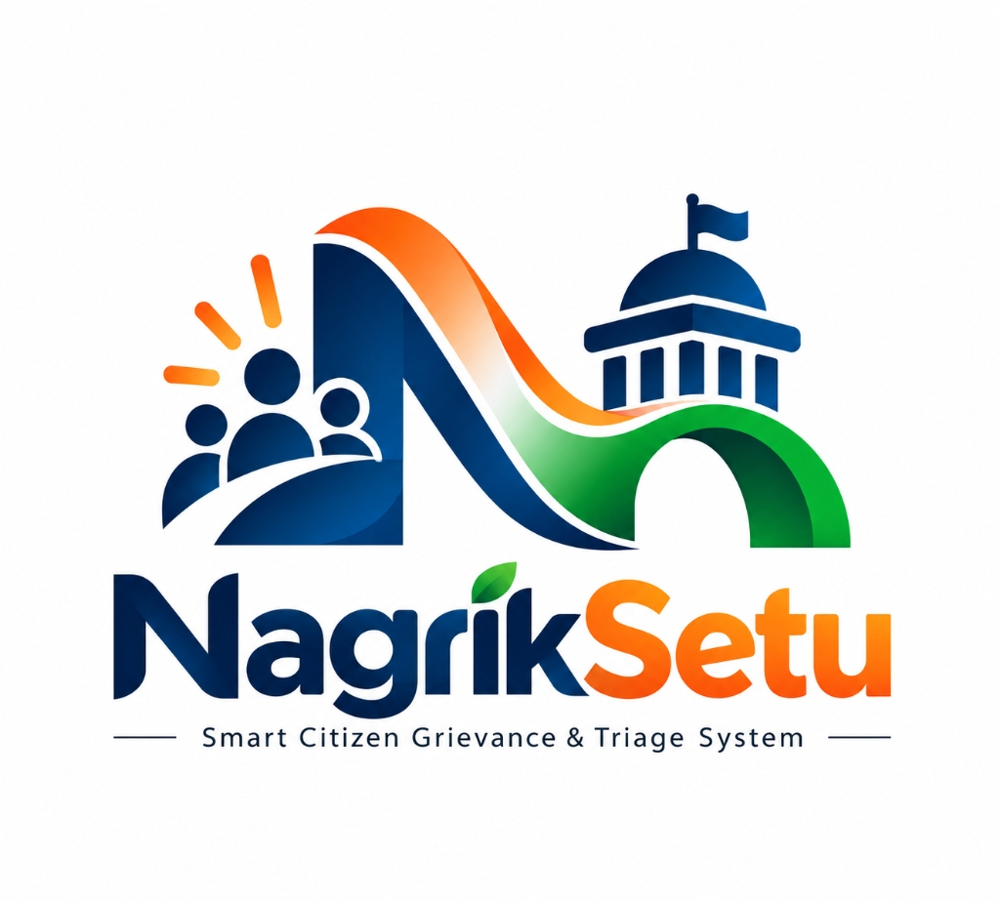
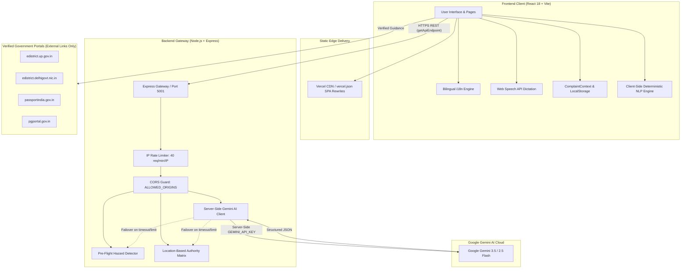

# NagrikSetu (नागरिकसेतु)

<div align="center">



### **Smart Citizen Grievance Triage, Authority Routing & Government Service Navigator**

*Bridging Citizens and Civic Governance with Multilingual AI Triage, Verified Authority Routing, and Procedural Guidance.*

[](https://vitejs.dev/)
[](https://react.dev/)
[](https://nodejs.org/)
[](https://expressjs.com/)
[](https://aistudio.google.com/)
[](tests/runAllTests.mjs)
[](LICENSE)

[**Live Demo Script**](DEMO_SCRIPT.md) · [**Project Overview**](PROJECT_OVERVIEW.md) · [**Technical Architecture**](TECHNICAL_ARCHITECTURE.md) · [**Judge Q&A**](HACKATHON_QA.md) · [**Checklist**](SUBMISSION_CHECKLIST.md)

</div>

---

## 📖 Table of Contents
- [Executive Summary](#-executive-summary)
- [The Problem We Solve](#-the-problem-we-solve)
- [Key Features](#-key-features)
- [System Architecture](#-system-architecture)
- [Tech Stack](#-tech-stack)
- [Quick Start Guide](#-quick-start-guide)
- [Automated Testing & Verification](#-automated-testing--verification)
- [Hackathon Demo Scenarios](#-hackathon-demo-scenarios)
- [Documentation Index](#-documentation-index)
- [Privacy, Safety & Disclaimers](#-privacy-safety--disclaimers)
- [License](#-license)

---

## 🏛️ Executive Summary

**NagrikSetu (नागरिकसेतु)** is an AI-powered citizen assistance platform designed to eliminate friction in Indian civic grievance reporting and public service navigation.

In India's complex urban landscape, citizens frequently face jurisdictional confusion, language barriers, and procedural opacity. NagrikSetu introduces a citizen-first digital layer between residents and public administrative bodies:
- Translates informal, colloquial descriptions (in English, Hindi, or Hinglish) into structured, professional citizen-charter grievance letters.
- Intelligently maps issues to the exact responsible government department (e.g., Agra Nagar Nigam, Jal Sansthan, DVVNL, MCD, PWD) based on location and road classification.
- Pre-emptively intercepts life-threatening emergencies (e.g., exposed sparking electrical wires, deep open manholes) with immediate 112/1912 safety guidance before paperwork.
- Provides interactive, state-specific document checklists and verified links to official government portals (`.gov.in` / `.nic.in`) for essential certificates and passport services.
- Employs a **Dual-Engine Architecture**: Powered by Google Gemini AI with resilient local deterministic NLP fallbacks for 100% operational uptime.

---

## 🚨 The Problem We Solve

1. **Jurisdictional Maze:** Municipal corporations, urban development authorities, state public works departments, water boards, and power distribution companies operate side-by-side. Citizens rarely know which agency maintains their specific street width or colony.
2. **High Rejection Rates for Informal Complaints:** Grievances submitted in raw, unstructured language often omit key landmarks or statutory details, causing administrative delays or dismissal.
3. **Emergency Hazards Lost in Administrative Queues:** Life-threatening hazards (e.g., hanging high-tension wires) often get queued alongside non-urgent routine maintenance tickets.
4. **Information Asymmetry in Government Services:** Securing basic statutory documents (Income Certificates, Domicile Certificates, Passports) often forces citizens toward unauthorized touts due to opaque procedural requirements.

---

## ✨ Key Features

### 1. Multilingual Civic Grievance Triage
- Accepts text and voice dictation in **English, Hindi (Devanagari), and Hinglish (Latin)**.
- Analyzes complaints across core municipal categories: Garbage/Sanitation, Roads/Potholes, Streetlights, Water Supply, and Drainage/Sewage.
- Evaluates urgency levels (Low, Medium, High) with contextual reasoning based on public health and transit impact.

### 2. Standard Citizen Charter Grievance Generation
- Automatically formats informal complaints into formal administrative representations.
- Generates precise subject lines, formal salutations addressed to competent officers (e.g., *Municipal Commissioner, Agra Nagar Nigam*), structured factual narratives, and citizen charter SLA references.

### 3. Pre-Flight Emergency Safety Interceptor
- Scans inputs for acute physical hazards *before* invoking standard municipal classification.
- Triggers high-visibility safety warnings with minimum 10-meter perimeter evacuation instructions.
- Provides immediate one-touch emergency calling for **112 (National Emergency Helpline)** and **1912 (All-India Electricity Discom Helpline)**.

### 4. Location-Based Authority Detection Engine
- Resolves jurisdictions across **Agra (Uttar Pradesh), Delhi NCT, Noida, Greater Noida, Ghaziabad, Gurugram, and Faridabad**.
- Disambiguates between municipal colony roads and major arterial highways/flyovers (PWD/NHAI).
- Provides confidence scoring (`High`, `Medium`, `Low`) and direct links to verified municipal portals.

### 5. Government Service Navigator & Interactive Checklists
- Guides citizens through statutory certification: **Birth Certificate, Income Certificate (Aay Praman Patra), Domicile/Residence Certificate, and National Passport Services**.
- State-aware filtering between Uttar Pradesh (Agra) and Delhi NCT.
- Interactive document checklists allow citizens to check off verified prerequisites with local browser state persistence.
- **Zero Document Uploads:** Does not collect or store sensitive Aadhaar or identity cards.

### 6. Unified AI Citizen Assistant
- Conversational chat interface supporting multi-turn memory and 7 distinct conversational intents.
- Provides contextual quick-action suggestion pills and transparent indicators when operating in AI-assisted or fallback mode.

### 7. Civic Grievance Tracking Ledger
- Prototype citizen dashboard (`/complaints`) with SLA target countdowns.
- Chronological status timeline (`Created` → `Prepared` → `Under Review` → `Resolved`).
- Prefixed with `Local Ref: NS-XXXX` badges to distinguish local session records from official government tracking numbers.

---

## 🏗️ System Architecture



---

## 💻 Tech Stack

| Layer | Technology | Purpose |
| :--- | :--- | :--- |
| **Frontend Framework** | **React 18** | Modular component-driven UI |
| **Build Tool** | **Vite 8.3** | Ultra-fast client compilation and HMR |
| **Styling** | **Tailwind CSS** | Responsive civic design system and Indian tricolor palette |
| **Routing** | **React Router DOM v7** | Client-side SPA routing with 404 rewrite support |
| **Backend Runtime** | **Node.js 20+ / Express 4** | Secure API gateway, rate limiting, and AI proxy |
| **AI Integration** | **@google/genai** | Multimodal comprehension via Gemini 3.5 / 2.5 Flash |
| **Speech Engine** | **Web Speech API** | In-browser speech-to-text dictation |
| **Linting & Code Quality** | **Oxlint** | High-performance static analysis (0 errors) |

---

## 🚀 Quick Start Guide

### Prerequisites
- Node.js version 18.x or 20.x
- npm version 9.x or higher
- A Google Gemini API Key from [Google AI Studio](https://aistudio.google.com/)

### 1. Clone & Install Dependencies
```bash
git clone https://github.com/your-username/nagriksetu.git
cd nagriksetu
npm install
```

### 2. Configure Environment Variables
Copy the template and add your Gemini API key:
```bash
cp .env.example .env
```
Edit `.env`:
```ini
# Server-side only (Secret)
GEMINI_API_KEY=your_gemini_api_key_here
GEMINI_MODEL=gemini-3.5-flash
PORT=5001

# CORS & Frontend Origins
ALLOWED_ORIGINS=http://localhost:5173,http://localhost:3000

# Frontend API URL (leave blank for local Vite proxy)
VITE_API_URL=
```

### 3. Launch Development Environment
In terminal 1 (start backend API server):
```bash
npm run server
```

In terminal 2 (start Vite frontend dev server):
```bash
npm run dev
```

Open your browser at `http://localhost:5173`.

---

## 🧪 Automated Testing & Verification

NagrikSetu includes a unified test runner verifying 11 distinct test suites:

```bash
# Run all 11 test suites
npm test

# Run linter
npm run lint

# Build production bundle
npm run build
```

### Test Suite Coverage:
1. `tests/testAnalyzer.mjs` — Keyword & NLP Engine
2. `tests/testNavbar.mjs` — Navbar & Route Contracts (38/38 contract assertions passed)
3. `tests/testPhase3.mjs` — Formal Grievance Generation Engine
4. `tests/testPhase4.mjs` — Authority Redressal & Mapping
5. `tests/testPhase5.mjs` — Tracking Ledger & State Persistence
6. `tests/testPhase6.mjs` — Voice & Accessibility Engine
7. `tests/testGeminiAnalysis.mjs` — Gemini AI Integration Engine
8. `tests/testEmergencyClassification.mjs` — Emergency Safety Hazard Classification
9. `tests/testAuthorityDetection.mjs` — Location-Based Authority Detection
10. `tests/testGovernmentServices.mjs` — Government Service Navigator
11. `tests/testUnifiedAssistant.mjs` — Unified AI Citizen Assistant (63/63 assertions passed)

---

## 🎭 Hackathon Demo Scenarios

NagrikSetu comes prepared with three timecoded live demonstration scenarios:

* **Scenario 1: Garbage Grievance in Agra**
  * Input: *"Sanjay Place market me 4 din se kachra jama hai, bahut badbu aa rahi hai"*
  * Result: Categorized under Garbage; maps to **Agra Nagar Nigam**; drafts formal letter to Municipal Commissioner.
* **Scenario 2: UP Income Certificate Navigator**
  * Input: *"Mujhe college scholarship ke liye income certificate banwana hai"*
  * Result: Matches UP Income Certificate; presents interactive document checklist; links directly to **edistrict.up.gov.in**.
* **Scenario 3: Emergency Electrical Hazard**
  * Input: *"Broken live electrical wire sparking dangerously near a street pole"*
  * Result: Pre-flight interception; high-voltage warning; one-touch calling for **112** and **1912**.

See [DEMO_SCRIPT.md](DEMO_SCRIPT.md) for the exact step-by-step presenter walkthrough.

---

## 📚 Documentation Index

| Document | Purpose |
| :--- | :--- |
| [PROJECT_OVERVIEW.md](PROJECT_OVERVIEW.md) | Problem statement, target users, innovation matrix, social impact |
| [TECHNICAL_ARCHITECTURE.md](TECHNICAL_ARCHITECTURE.md) | System design, Mermaid diagrams, API specs, security rules |
| [DEMO_SCRIPT.md](DEMO_SCRIPT.md) | 3-minute timecoded script for live presentation |
| [HACKATHON_QA.md](HACKATHON_QA.md) | Strategic answers to 15 tough judge and mentor questions |
| [SUBMISSION_CHECKLIST.md](SUBMISSION_CHECKLIST.md) | Comprehensive pre-submission audit and verification checklist |

---

## 🛡️ Privacy, Safety & Disclaimers

1. **Independent Civic Platform:** NagrikSetu is an independent citizen assistance prototype developed for educational and hackathon purposes. It is **not** an official government agency and is not formally affiliated with any municipal body.
2. **Zero Sensitive Document Uploads:** NagrikSetu never asks for, collects, or stores citizen identity cards (Aadhaar, PAN, voter ID, passports). Checklists are purely interactive guides stored on your local device.
3. **Local Reference Ledger:** Complaint reference IDs (`NS-XXXX`) in this prototype represent local session tracking drafts and are not official government registration numbers.
4. **Emergency Services:** NagrikSetu does not dispatch first responders. For active fires, medical emergencies, or physical hazards, citizens must contact emergency services directly via **112** or **1912**.

---

## 📄 License

Distributed under the MIT License. See `LICENSE` for more information.

---

<div align="center">
  <b>Built with ❤️ for Indian Citizens and the Social Impact Hackathon 2026.</b>
</div>
