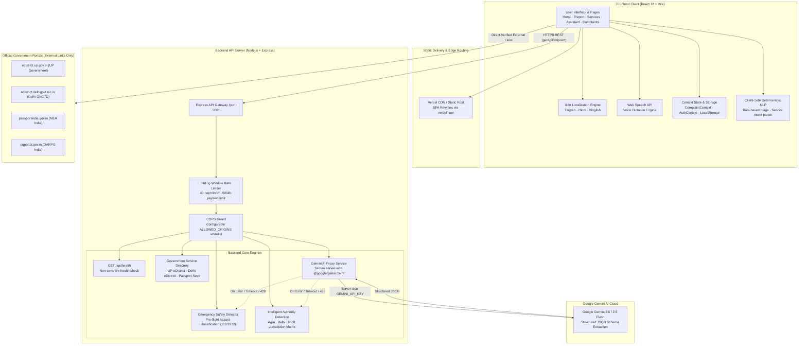
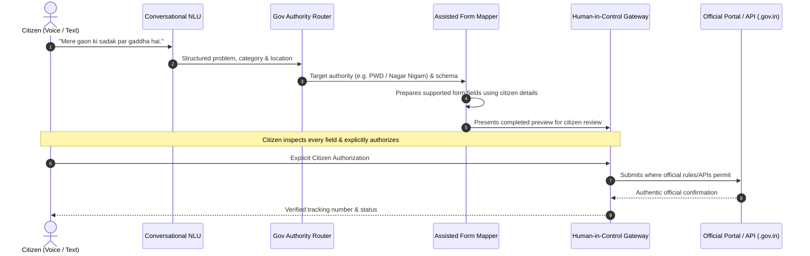

# NagrikSetu (नागरिकसेतु) — Technical Architecture

> **Comprehensive Technical Architecture, System Design & Security Specification**  
> *Stack: React 18 · Vite · Tailwind CSS · Node.js · Express · Google Gemini AI*

---

## 1. High-Level System Architecture Diagram

---

## 2. Frontend Architecture
The client application is built with **React 18** and **Vite**, structured around modular components, dedicated page views, and decoupled state providers:

* **Build Tooling & Fast Bundling:** Powered by Vite with Oxlint static analysis. Builds the entire production client in under 300ms.
* **Component-Driven Layouts:**
  - `Layout.jsx`: Symmetrical masthead, tricolor ribbons, responsive navigation, and footer.
  - `Navbar.jsx`: Global navigation bar adhering strictly to civic portal branding and responsive hamburger toggle.
  - `ComplaintForm.jsx`: Multi-step grievance reporting supporting voice dictation, photo attachments, category selection, and location inputs.
  - `AnalysisResultCard.jsx` & `ComplaintPreviewCard.jsx`: Interactive display of AI triage results and formal administrative grievance drafts.
  - `AuthorityRecommendationCard.jsx`: Visualizes matched governing authorities, jurisdiction justifications, confidence scores, and official portal links.
  - `AssistantPage.jsx`: Multi-turn conversational interface with responsive chat bubbles, suggested action chips, and transparent AI/fallback status badges.
  - `ServicesPage.jsx` & `ServiceDetailsPage.jsx`: GovTech service directory with faceted filtering (state/category), search, and interactive document checklist checklists.
* **State Management:**
  - `ComplaintContext.jsx`: Manages complaint drafts, confirmed complaints ledger, counter IDs, and `localStorage` synchronization.
  - `AuthContext.jsx`: Prototype citizen profile state (name, mobile, ward, avatar).
  - `LanguageContext.jsx`: Real-time toggle between English and Hindi with synchronized translation dictionaries.
* **Client-Side SPA Routing & 404 Prevention:** Uses `react-router-dom` with `BrowserRouter`. `vercel.json` and `public/_redirects` enforce root rewrite rules so deep links (e.g., `/services/income-certificate-up`, `/assistant`, `/complaints`) do not return 404 on page refresh.
* **API Config Utility (`src/utils/apiConfig.js`):** Resolves API endpoints dynamically based on execution context:
  - In development: Uses relative `/api/...` proxies through Vite to avoid CORS issues.
  - In cloud deployment: Prepends `VITE_API_URL` when frontend and backend are hosted on separate domains.
  - In Node.js testing: Targets `http://localhost:${PORT || 5001}` automatically.

---

## 3. Backend Architecture
The backend is a lightweight, secure **Node.js + Express** service (`server/index.js`):

* **Single-Responsibility Gateway:** Acts as a secure, authenticated bridge between the browser client and the Google Gemini API.
* **Network & Security Middlewares:**
  - **CORS Whitelisting:** Enforces origin checks based on `process.env.ALLOWED_ORIGINS` (or permits open testing if unconfigured).
  - **Payload Size Guards:** Rejects payloads exceeding `500kb` to protect against denial-of-service memory exhaustion.
  - **Sliding-Window IP Rate Limiter:** Limits clients to a maximum of 40 requests per minute per IP address, responding with HTTP `429 Too Many Requests`.
  - **Input Sanitization:** Caps string parameters (max 3000 characters for complaints, 1000 characters for service queries).
* **Graceful Degradation:** All route handlers wrap external calls in `try/catch` blocks. If Google Gemini API encounters a quota limit, network timeout, or invalid key, the server **never crashes**; it immediately falls back to deterministic rule-based engines, ensuring 100% workflow uptime.

---

## 4. Google Gemini AI Integration
* **Library:** Official `@google/genai` SDK (`GoogleGenAI`).
* **Model Configuration:** Configurable via `process.env.GEMINI_MODEL`, defaulting to `gemini-3.5-flash` for high speed, low latency, and cost-free hackathon execution.
* **Credential Isolation:** `GEMINI_API_KEY` is loaded exclusively from `.env` on the server. No client-facing code or bundle contains the key.
* **Structured JSON Generation:** Prompts instruct Gemini with precise system instructions and JSON schemas, avoiding free-form prose. The output includes:
  - `category` (Garbage, Road/Pothole, Streetlight, Water, Drainage, Unsupported)
  - `subcategory` & `summary`
  - `urgency` (Low, Medium, High) with `urgencyReason`
  - `isEmergency` flag and hazard classification
  - `missingInformation` array (e.g. ward, landmark)
  - `formalRepresentation` letter adhering to standard Indian citizen charter norms.

---

## 5. Complaint Classification & Authority Detection Engine
1. **Classification Pipeline:**
   - Evaluates input through multilingual keyword dictionaries covering English, Devanagari Hindi, and Latin Hinglish.
   - Computes urgency based on safety keywords (flooding, contamination, school/hospital vicinity, prolonged duration).
2. **Authority Detection (`src/services/authorityService.js`):**
   - **Jurisdiction Coverage:** Agra (Agra Nagar Nigam, ADA, Jal Sansthan, UP PWD, Torrent Power Agra, DVVNL), Delhi NCT (MCD, NDMC, DJB, PWD Delhi, BSES BRPL/BYPL, Tata Power DDL), Noida, Greater Noida, Ghaziabad, Gurugram, and Faridabad.
   - **Arterial Road Disambiguation:** Differentiates between internal colony roads (handled by Municipal Corporations / MCD / ANN) and major arterial highways/flyovers (handled by state PWD or NHAI).
   - **Confidence Metric:** Computes `High`, `Medium`, or `Low` confidence based on landmark specificity and municipal boundary matching.

---

## 6. Pre-Flight Emergency Safety Interceptor
* **Design Philosophy:** Life safety overrides administrative paperwork.
* **Execution Order:** Operates **before** the 5-category municipal classifier or Gemini AI call.
* **Detection Criteria:** Scans for acute electrical hazards (hanging live wires, sparking poles), deep open manholes, active gas pipeline leaks, and flash flooding.
* **Safety Protocol:**
  - Halts standard administrative submission.
  - Prompts immediate physical perimeter evacuation (minimum 10 meters / 33 feet).
  - Displays one-touch emergency dialers for **112** (National Emergency Response System) and **1912** (All-India Electricity Discom Helpline).
  - Explicitly states: *"NagrikSetu is an administrative tool and has NOT dispatched emergency responders. You must place an emergency call directly."*

---

## 7. Government Service Navigator Engine
* **Catalog:** Covers Delhi e-District, UP eDistrict (Agra/Noida/Ghaziabad), and Passport Seva.
* **Deterministic Intent Parser:** Recognizes service inquiries in colloquial phrasing (e.g., *"mujhe income certificate banwana hai"*, *"delhi birth certificate documents"*).
* **Interactive Document Checklists:** Each service defines verified mandatory and optional documents with notes (e.g., UP standard self-declaration undertaking, khatoni land records). Citizens can check off documents as they prepare them, with state preserved in `localStorage`.
* **Zero Document Uploads:** NagrikSetu **never asks for or stores** copies of citizen identity documents (Aadhaar, PAN, voter cards), ensuring zero risk of data leakage.

---

## 8. Data Storage & Privacy Safety
| Data Type | Storage Mechanism | Privacy Guard |
| :--- | :--- | :--- |
| **Grievance Drafts** | Browser `localStorage` | Stored locally on user device; never synced to third-party databases. |
| **Confirmed Grievance Ledger** | Browser `localStorage` | Prefixed with `Local Ref: NS-XXXX`; explicitly labeled as prototype reference. |
| **Document Checklists** | Browser `localStorage` | Boolean checkmarks only; no personal identity numbers or files stored. |
| **Citizen Profile** | Browser `localStorage` | Simulated profile (name, ward); no passwords or Aadhaar numbers collected. |
| **AI Conversations** | Browser `sessionStorage` | Ephemeral; clears upon session end or via "Clear Chat" button. |
| **API Keys** | Server Environment Variable | Server-side only; zero client bundle exposure. |

---

## 9. Security Limitations & Operational Boundaries
1. **Mock Authentication:** The citizen login and DigiLocker SSO are demonstration prototypes; they are not connected to production OAuth servers or UIDAI biometric authentication.
2. **Prototype Ledger:** Confirmed grievances are assigned local reference numbers (`NS-1024`) for tracking demonstration; they are not submitted directly into government NIC databases or municipal ERPs.
3. **Official Portals:** For formal statutory certification (Income, Caste, Domicile, Passport), NagrikSetu acts as an educational and procedural navigator; citizens must submit final verified forms on the official `.gov.in` portals provided.

---

## 10. Future Agentic Automation Architecture & Security Guardrails

### 10.1 Automation Pipeline Architecture (Future Vision)
The planned agentic layer is designed to bridge the digital literacy divide through a secure, multi-stage pipeline:

### 10.2 Security & Ethical Automation Rules
Future automation will strictly enforce:
1. **Explicit Citizen Authorization:** Every form fill and submission requires affirmative citizen approval. No autonomous submissions.
2. **Zero CAPTCHA / OTP Bypass:** Human citizens must personally solve CAPTCHA challenges and enter SMS OTP credentials. NagrikSetu will never automate or circumvent security barriers.
3. **No Impersonation:** The system acts strictly as an authorized digital scribe on behalf of the citizen with logged user consent.
4. **Data Minimization & Local Privacy:** Personal details are processed in client-side secure memory; no third-party database harvesting.
5. **Verified Confirmation Integrity:** The platform displays official confirmation codes only when the government portal actually confirms successful submission.
6. **Graceful Manual Fallback:** Citizens can download standard pre-filled grievance representations at any stage for manual or offline submission.
7. **Transparent Attribution:** Clear disclaimer that NagrikSetu is an independent civic assistance technology and never claims official government affiliation.
